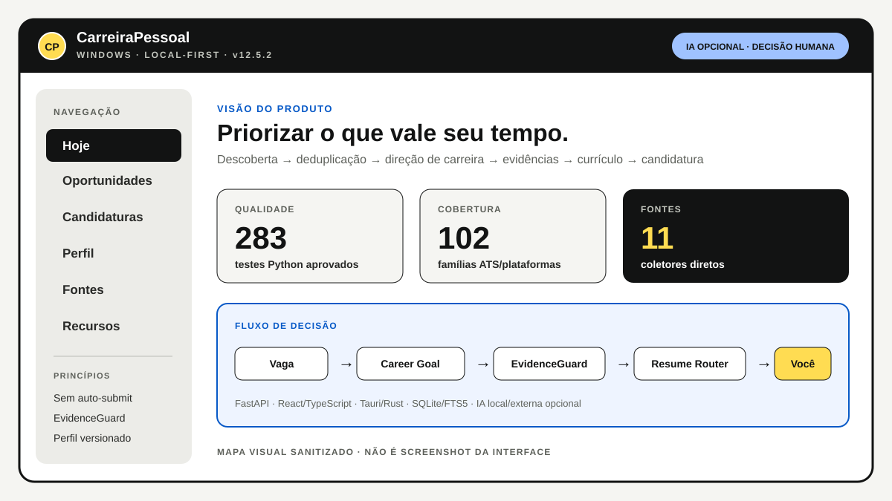
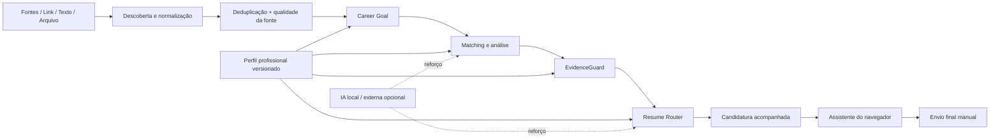

<div align="center">

# CarreiraPessoal

**Protótipo pessoal local-first para explorar descoberta de vagas, direção de carreira, evidências e currículo — sem auto-submit.**

[](https://github.com/Mayconxzdev/CarreiraPessoal/actions/workflows/portfolio-check.yml)
[](https://github.com/Mayconxzdev/CarreiraPessoal/actions/workflows/python-tests.yml)


[Portfólio](https://mayconxzdev.github.io/cases/carreira-pessoal/) · [Demo autocontida](demo/README.md) · [Arquitetura](docs/ARCHITECTURE.md) · [Guia de revisão](docs/CODE_REVIEW_GUIDE.md) · [Testes](docs/TESTING.md) · [AI System Card](docs/AI_SYSTEM_CARD.md)

</div>

> Aplicativo que criei para organizar minha própria busca de vagas: descobrir oportunidades, evitar duplicidade, comparar a vaga com o meu objetivo profissional, manter evidências atualizadas e preparar o currículo certo sem enviar nada sozinho.

## Por que eu fiz

Eu estava gastando tempo procurando vagas em vários sites, revendo as mesmas oportunidades e atualizando currículo e evidências manualmente. A ideia do CarreiraPessoal foi juntar isso em um fluxo só e deixar a parte repetitiva por conta do sistema, mantendo a decisão final comigo.

A arquitetura foi **projetada para funcionar sem IA no núcleo**. IA local ou externa é opcional em tarefas específicas; essa decisão arquitetural não equivale a comprovação de uso ponta a ponta.

**Estado atual (novembro/2026): protótipo pessoal incompleto; a versão integral não teve seu fluxo de ponta a ponta homologado.** A tag histórica **v12.5.2** e seus relatórios de testes não equivalem a produto pronto ou utilizado integralmente.

## O produto por dentro

<p align="center">
  
</p>

O visual acima é um **mapa sanitizado do produto, não uma captura da interface**. Ele mantém a navegação, os principais controles e as métricas que podem ser mostradas publicamente sem depender de um arquivo externo do portfólio. Candidaturas, credenciais e dados pessoais continuam fora desta edição. O [case do portfólio](https://mayconxzdev.github.io/cases/carreira-pessoal/) explica o fluxo com mais contexto.

## Escopo do protótipo e funcionalidades relatadas

Os itens abaixo descrevem funcionalidades implementadas ou planejadas na versão privada em diferentes níveis de maturidade. **Não significam que cada jornada foi validada ponta a ponta.** O recorte público reproduz exclusivamente os gates de demonstração incluídos em `demo/`.

- descoberta em múltiplas fontes com deduplicação e medição de rendimento por fonte;
- entrada de vaga por **link, descrição ou arquivo**;
- Career Goal Gate para evitar priorizar vaga tecnicamente parecida, mas fora da direção profissional configurada;
- matching semântico local e análise de aderência;
- perfil profissional versionado com currículo, GitHub, portfólio, fatos e projetos;
- EvidenceGuard para bloquear afirmações sensíveis sem evidência suficiente;
- Resume Router/Fitness para selecionar e preparar o currículo adequado;
- acompanhamento da candidatura em linha do tempo;
- extensão/assistente de navegador para ajudar no preenchimento, mantendo o **envio final manual**;
- recursos locais opcionais como Ollama, LM Studio, containers, SearXNG e Qdrant;
- funcionamento adaptável ao computador, sem tornar esses recursos obrigatórios.

## Evidências e limites de validação

Relatórios históricos da versão privada registraram **283 testes Python**, outras **6 validações**, **102 famílias ATS** e **11 coletores**. Esses totais **não foram reexecutados integralmente nesta edição pública e não comprovam utilização completa do aplicativo**.

A demonstração pública contém uma suíte própria pequena. Uma revisão externa também identificou um caso de incompatibilidade de senioridade (vaga júnior classificada como alinhada a preferência sênior), que precisa de correção e testes de regressão. O conjunto atual **não deve ser apresentado como produto homologado**.

Este repositório é uma edição sanitizada para avaliação parcial, sem dados pessoais, credenciais e banco de candidaturas.

## Stack

`Python` · `FastAPI` · `SQLAlchemy` · `SQLite/WAL/FTS5` · `React` · `TypeScript` · `Vite` · `Tauri v2 / Rust` · `browser extension MV3` · `Docker/Podman opcional` · `Ollama/LM Studio opcional`

## Como organizei a arquitetura



A arquitetura e as decisões principais estão detalhadas em [`docs/ARCHITECTURE.md`](docs/ARCHITECTURE.md) e [`docs/DECISIONS.md`](docs/DECISIONS.md). A fronteira entre IA, evidência, privacidade, provedores e decisão humana está documentada em [`docs/AI_SYSTEM_CARD.md`](docs/AI_SYSTEM_CARD.md).

## Se quiser avaliar o código, comece aqui

Para uma avaliação reproduzível sem dependências privadas, comece pela [`demo/`](demo/README.md). Ela executa somente com a biblioteca padrão do Python e demonstra, com dados sintéticos, os contratos públicos de **Career Goal, EvidenceGuard e Resume Router**, incluindo testes automatizados no GitHub Actions.

Depois, esta edição pública traz módulos representativos retirados e sanitizados da versão completa:

1. [`demo/standalone_demo.py`](demo/standalone_demo.py) — demonstração autocontida dos três gates, sem banco ou serviços externos;
2. [`demo/test_standalone_demo.py`](demo/test_standalone_demo.py) — testes reproduzíveis para direção profissional, evidência e roteamento;
3. [`examples/career_goal.py`](examples/career_goal.py) — recorte sanitizado do gate determinístico de direção profissional;
4. [`examples/evidence_guard.py`](examples/evidence_guard.py) — valida claims contra fatos/projetos atuais e trata métricas, senioridade, produção e liderança de forma conservadora;
5. [`examples/resume_router.py`](examples/resume_router.py) — recorte sanitizado de roteamento/fitness de currículo;
6. [`docs/ARCHITECTURE.md`](docs/ARCHITECTURE.md) — visão da arquitetura;
7. [`docs/TESTING.md`](docs/TESTING.md) — estratégia e evidências de teste;
8. [`docs/AI_SYSTEM_CARD.md`](docs/AI_SYSTEM_CARD.md) — papel da IA, controles, riscos e dependências externas.

> Os arquivos em `examples/` continuam sendo **trechos sanitizados**, não um pacote standalone. Algumas dependências (`app.models`, serviços e banco) pertencem ao workspace privado porque contêm a implementação completa e estruturas ligadas ao meu uso pessoal. A pasta [`demo/`](demo/README.md) foi criada justamente para permitir avaliação executável sem essas dependências.

## Segurança e limites que eu escolhi de propósito

- não existe auto-submit de candidatura;
- CAPTCHA, termos do site e confirmação final continuam humanos;
- dados pessoais e credenciais não fazem parte da edição pública;
- IA não cria experiência profissional nem métricas que não estejam no perfil/evidências;
- o sistema pode funcionar sem provedor de IA;
- extensões e recursos opcionais não viram dependências obrigatórias do núcleo.

Mais detalhes em [`docs/PRIVACY.md`](docs/PRIVACY.md) e [`docs/AI_SYSTEM_CARD.md`](docs/AI_SYSTEM_CARD.md).

## O que eu faria diferente hoje

O protótipo cresceu bastante desde a primeira versão. Se eu começasse de novo, eu definiria mais cedo a separação entre **núcleo obrigatório**, **recursos opcionais** e **integrações externas**. Foi uma das lições que mais ajudou nas versões recentes: o aplicativo ficou mais portátil e previsível quando parei de tratar ferramentas extras como parte obrigatória do produto.

Também passei a separar melhor **aderência técnica** de **direção de carreira**. Uma vaga pode combinar com minhas tecnologias e ainda assim não me levar para o tipo de trabalho que eu quero; por isso o Career Goal virou um componente próprio.

## Testes

O histórico privado registra uma suíte maior, mas sua existência e suas aprovações **não substituem uma homologação funcional real**. A edição pública foi reduzida a componentes demonstrativos e inclui falhas conhecidas que ainda precisam ser corrigidas. Não confunda o retorno de um teste de unidade com a prova da jornada de candidatura completa.

Demo pública:

```bash
python demo/standalone_demo.py
python -m unittest discover -s demo -p "test_*.py" -v
```

## Autor

**Maycon Ferreira**<br>
Técnico Júnior em Automação de Processos · sistemas e integrações<br>
[Portfólio](https://mayconxzdev.github.io/) · [LinkedIn](https://www.linkedin.com/in/maycon-ferreira-7bb870231/)
